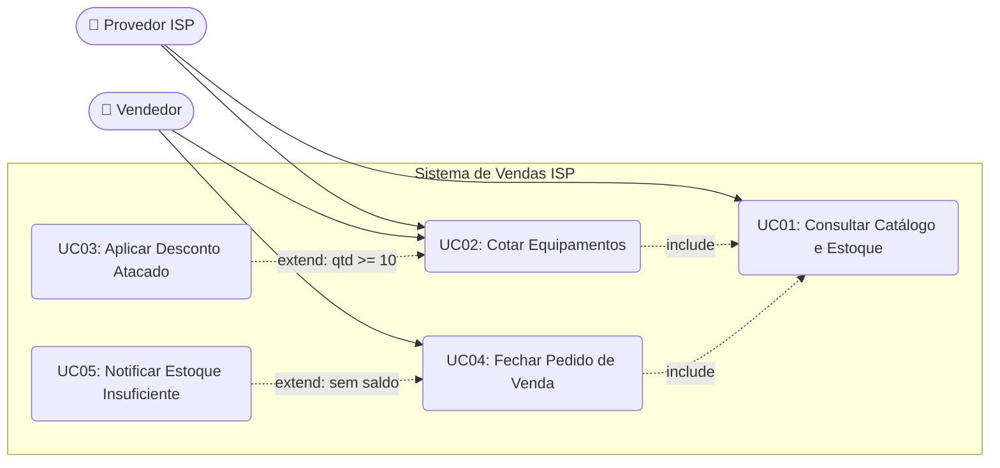
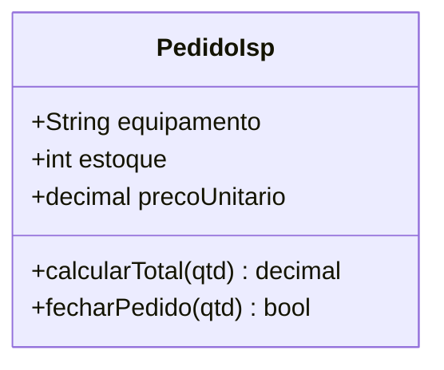

Projeto – ARA0097 (Aula 11): Gerência de Configuração e Git

Integrantes

TAIGOR DE JESUS SANTOS RODRIGUES 2026 0347 4437

Projeto ARA0097 – Gerência de Configuração e Git

# 📡 Vendas ISP — Controle de Pedidos Telecom

Projeto prático de Engenharia de Software demonstrando a aplicação de **Upper CASE**, **Lower CASE** e **Integrated CASE** no cenário real de vendas de equipamentos eletrônicos (ONUs, OLTs, Roteadores e Cabos Fibra Óptica) para provedores de internet (ISPs).

---

## 1. Upper CASE (Requisitos → Análise → Projeto)

### Requisitos do Sistema
* **RF01 - Cálculo de Desconto Atacado:** Na compra de 10 ou mais unidades de um equipamento (ex: ONUs), aplicar 10% de desconto no valor total.
* **RF02 - Validação e Baixa de Estoque:** O pedido só pode ser aprovado se houver estoque suficiente, abatendo a quantidade vendida em seguida.

### Prompt Utilizado na IA
> "Crie um diagrama UML de casos de uso para venda de equipamentos eletrônicos para provedores de internet (ISPs). Atores: Provedor e Vendedor. Inclua cotar equipamentos, consultar estoque e fechar pedido."

### Diagrama de Casos de Uso (UML)

### Validação Humana (Análise Crítica do Diagrama)
Após a geração inicial pela IA, foi realizada uma revisão técnica para garantir a fidelidade ao negócio de Telecom:

1. **Os atores estão corretos?**
   * **Sim.** O **Provedor ISP** atua como cliente B2B que consulta preços e monta cotações, enquanto o **Vendedor** valida as condições comerciais e efetiva o fechamento do pedido.
2. **Faltam exceções?**
   * **Ajustado na revisão:** A IA inicialmente gerou apenas o fluxo principal. Foi adicionado o caso de uso **`UC05: Notificar Estoque Insuficiente`** (`extend`) ligado ao fechamento do pedido, tratando a exceção de falta de saldo físico antes de faturar.
3. **As regras de negócio estão representadas?**
   * **Ajustado na revisão:** Foi incluída a regra de desconto por volume de caixa fechada através do **`UC03: Aplicar Desconto Atacado`** (`extend`), ativado quando a cotação atinge 10 ou mais unidades. O vínculo `include` com **`UC01`** garante que nenhuma venda ocorra sem checagem prévia de estoque.

### Diagrama de Classes (UML)

### Ferramentas CASE Utilizadas
* **Mermaid.js:** Renderização nativa dos diagramas UML diretamente no GitHub Markdown.
* **diagrams.net (draw.io):** Validação visual da estrutura UML antes da documentação final.

---

## 2. Lower CASE (Codificação → Testes → Manutenção)
* **Linguagem e IDE:** Desenvolvido em **C# (.NET 8)** no arquivo [`src/PedidoIsp.cs`](./src/PedidoIsp.cs).
* **Testes Automatizados:** Validação unitária das regras de desconto (RF01) e baixa de estoque (RF02).
* **Automação CI/CD:** Pipeline configurado em [`.github/workflows/testes.yml`](./.github/workflows/testes.yml) via **GitHub Actions**, compilando e testando o sistema a cada novo commit.

---

## 3. Integrated CASE (Rastreabilidade Ponta a Ponta)

O ecossistema do GitHub integra todas as fases do ciclo de vida do software, conectando os requisitos iniciais ao código testado:

| Requisito | Caso de Uso (Upper) | Método no Código (Lower) | Rastreio no GitHub (I-CASE) |
| :--- | :--- | :--- | :--- |
| **RF01** | UC03 - Desconto Atacado | `CalcularTotal()` | Issue #1 |
| **RF02** | UC04 / UC05 - Baixa de Estoque | `FecharPedido()` | Issue #2 |
